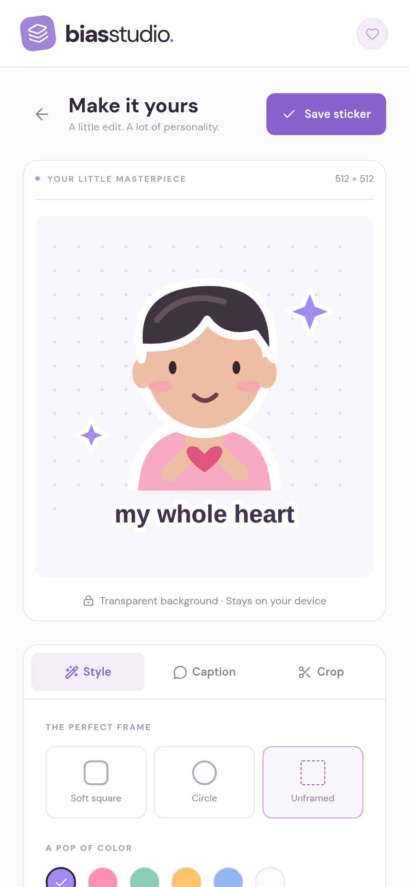
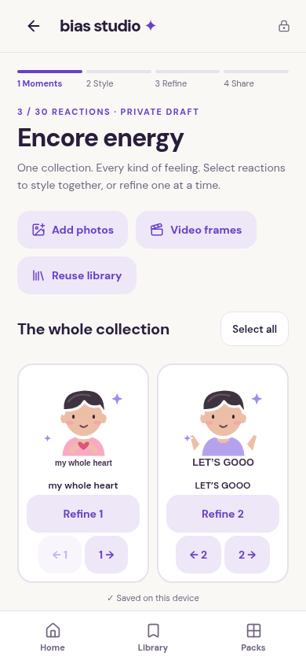

# Bias Studio

A React Native mobile app for fans to turn photos and selected video frames into personal WhatsApp sticker packs. Working name and original demo artwork are included; no idol photographs are bundled.

[](https://github.com/toreleon/bias-studio/actions/workflows/ci.yml)

CI runs quality checks, browser tests, and Android/iOS native builds. The [release gate guide](docs/RELEASING.md) explains protected main, human approval, immutable CI artifacts, and draft test candidates. GitHub administration settings must be activated separately with `npm run github:protect`; the release workflow blocks until those protections exist.

## Screenshots

Mobile browser previews using the original demo characters:

| Workshop | Sticker editor | Sticker pack |
| --- | --- | --- |
|  |  |  |

## First version

- iPhone and Android interfaces built with React Native and Expo SDK 54.
- Import photos through the system picker. Select a still frame from a video.
- Zoom, reposition, choose soft square/circle/unframed styles, add short captions, colors, hearts, and sparkles.
- Native person cutout with Apple Vision on iOS and bundled ML Kit selfie segmentation on Android. Images stay on the device.
- Create packs, save/delete stickers, delete packs, and keep the local library across restarts.
- Render transparent 512 × 512 WebP stickers, progressively compress to a maximum of 100 KB, and generate a 96 × 96 PNG tray icon under 50 KB.
- Validate WhatsApp's 3–30 sticker limits before handoff. Android uses a protected content provider and enable-pack intent. iOS uses WhatsApp's local pasteboard protocol.
- Download individual WebP stickers in the browser preview or use the native share sheet on a phone.

Video support currently means **still stickers from video frames**, not animated stickers. There is no backend, account, public feed, or cloud sync. The app does not upload your photos. Android person cutout uses Google’s ML Kit SDK; review its SDK privacy terms when preparing store disclosures. System backups are governed by the OS; Android backup is disabled in app configuration.

## Run the browser preview

Requires Node.js 20.19+ and npm. Node.js 22 LTS is recommended.

```sh
npm ci
npm run web
```

Open the URL printed by Expo (port 8081). Try the original demo characters, or import your own PNG/JPEG or MP4. Browser libraries live in local storage and are subject to its quota. Private browsing and clearing site data can remove your packs.

The browser preview supports the real editor, video frame selection, pack persistence, and WebP downloads. Person cutout and WhatsApp pack installation require a native build. The app explains this when those actions are selected.

## Build for phones

**Expo Go does not include the custom native module.** Use an Expo development build or a standalone build. The native module is included in `modules/fan-stickers` and autolinks during prebuild. Generated `android/` and `ios/` folders are disposable; source changes belong in the module or app configuration.

### Android, locally

Install Android Studio, Android SDK platform 36, the corresponding build tools, and JDK 17. Configure `ANDROID_HOME` and connect a phone with USB debugging, or start an emulator.

```sh
npm ci
npm run android
```

Expo generates the native project and builds it. Android 7.0+ is the Expo baseline. Test WhatsApp handoff with WhatsApp installed on a real phone.

### iPhone, locally

Use macOS, Xcode, CocoaPods, an Apple signing team, and a connected iPhone. The Expo baseline is iOS 15.1+.

```sh
npm ci
npm run ios -- --device
```

Use a physical iPhone with WhatsApp installed to test the pasteboard handoff. A simulator cannot validate the real WhatsApp flow. Person cutout uses Vision's person segmentation rather than general object segmentation.

### Cloud builds with EAS

Build profiles are in `eas.json`. Sign in to your own Expo account, link the project, and provide signing credentials when EAS requests them. No account or signing credentials are included in this project.

```sh
npx eas-cli login
npx eas-cli build:configure
npx eas-cli build --platform android --profile development
npx eas-cli build --platform ios --profile development
npm start
```

The Android development profile produces an APK. iOS device builds require Apple Developer membership and device provisioning. Replace `studio.bias.app` with your own bundle/package identifier before distribution.

To check iOS native compilation before setting up device signing, use the simulator profile:

```sh
npx eas-cli build --platform ios --profile ios-simulator
```

This needs an Expo/EAS account but no Apple device provisioning. The resulting app runs in an iOS simulator on a Mac; it cannot be installed on an iPhone and cannot verify WhatsApp handoff. Use the device development profile for that final check.

## Verify

```sh
npm run lint
npm run check
npx playwright install chromium
npm run test:e2e
npm run export:web
npx expo export --platform ios --platform android
```

To use an existing Chromium installation in CI:

```sh
CHROMIUM_PATH=/usr/bin/chromium CI=1 npm run test:e2e
```

The six domain tests cover pack limits, invalid assets, immutable edits, stored-library validation, and XML escaping. Six browser scenarios verify creation/reload of three-sticker packs, actual photo and video imports, crop controls, mobile layout, quota errors, WebP signatures, pixel dimensions, and transparent corners.

### Verification in the development environment

- TypeScript and all six domain tests passed.
- All six Playwright browser scenarios passed in Chromium, including a 390px mobile viewport.
- Web, iOS, and Android JavaScript bundles exported successfully. This verifies bundling, not native compilation.
- Expo prebuild succeeded for Android and iOS; autolinking found both native module implementations.
- Android release APK packaging and native compilation succeeded against Android SDK 36. APK signature verification passed. The test APK targets arm64 phones, includes its JavaScript bundle, and uses the template debug signing key. It is a local test build; production distribution needs your own signing configuration.
- Native device tests are still required. This Linux workspace has no Xcode or attached phone. iOS native compilation and actual WhatsApp acceptance have not been established here.
- Expo Doctor passed all 18 checks after using the environment proxy and correcting the native module peer declaration. `expo install --check` found dependency versions compatible.

## Device acceptance checklist

1. Import a photo, remove the background, and inspect edges on light and dark chat backgrounds. Try one clear person, multiple people, and a photo without a person.
2. Import a locally stored video, scrub to a later frame, caption it, and save it.
3. Make packs of 2, 3, and 30 stickers. Export must be unavailable for 2 and available for 3–30.
4. Export on Android and iPhone with WhatsApp installed. Confirm inside WhatsApp, send every sticker, and verify transparency, crop, legibility, and tray icon.
5. Try with WhatsApp absent, cancel adding the pack in WhatsApp, and return to the app. The app only reports that WhatsApp opened; it never claims installation succeeded.
6. Restart the app and phone, verify packs persist, and test permission denial and low storage without losing the existing library.
7. Rebuild after native changes; a JavaScript refresh cannot load a changed native module.

## Structure

```text
src/Studio.tsx             Navigation, library state, dialogs, save/export flows
src/Home.tsx               Workshop and original demo artwork entry points
src/Editor.tsx             Native sticker editor
src/ui.tsx                 Shared components and visual styles
src/domain.ts              Pack model and WhatsApp validation
src/scene.ts               Shared transparent SVG sticker composition
src/media.native.ts        Native import, thumbnail, capture, WebP, sharing
src/media.web.ts           Browser import, video frame decoding, canvas, download
src/storage.ts             Versioned local library; preserve unreadable data
modules/fan-stickers/      Kotlin/Swift person cutout and WhatsApp bridges
tests/                     Domain tests and browser scenarios
```

Native source images are not persisted in the library after rendering. Rendered stickers live in app document storage; temporary cutouts and thumbnails live in the app cache. Android exports keep immutable private snapshots so WhatsApp can read a consistent revision through the restricted provider. The provider serves only validated sticker/tray filenames, never original imported media. The iOS pasteboard handoff is local-only and expires after 60 seconds.

## Next development steps

The immediate next step is native compilation and the device acceptance checklist above. Before a public release, choose final branding and identifiers, test across phone sizes and OS versions, replace demo app icons if desired, and prepare store privacy details and screenshots.

Known first-version limits:

- Cutout targets people; it is not a general object eraser and has no manual edge repair.
- Long or unusually encoded video files depend on device codec support.
- Local packs are not portable across phones; there is no full-pack backup/import flow yet.
- Android WhatsApp exports use immutable revision identifiers. Exporting a changed pack can create a separate WhatsApp pack. Stable in-place pack updates and snapshot cleanup are follow-up work.
- Deleting a pack removes it from the app shelf; existing exported snapshots and WhatsApp's copy are retained. Uninstalling the app removes its private files.
- Accessibility and small-screen flows have browser coverage; VoiceOver/TalkBack and actual native screenshots still need device checks.

Animated WebP stickers, manual mask repair, and optional backup are sensible next features. Community sharing would add a separate backend, rights/reporting, moderation, and storage scope.

## Protocol references

- [Official WhatsApp sticker requirements and Android example](https://github.com/WhatsApp/stickers/tree/main/Android)
- [Official WhatsApp iOS pasteboard protocol](https://github.com/WhatsApp/stickers/tree/main/iOS)
- [Apple Vision person segmentation](https://developer.apple.com/documentation/vision/vngeneratepersonsegmentationrequest)
- [ML Kit selfie segmentation](https://developers.google.com/ml-kit/vision/selfie-segmentation/android)

Use photos and videos you have permission to use. Bias Studio is not affiliated with WhatsApp or any artist.
