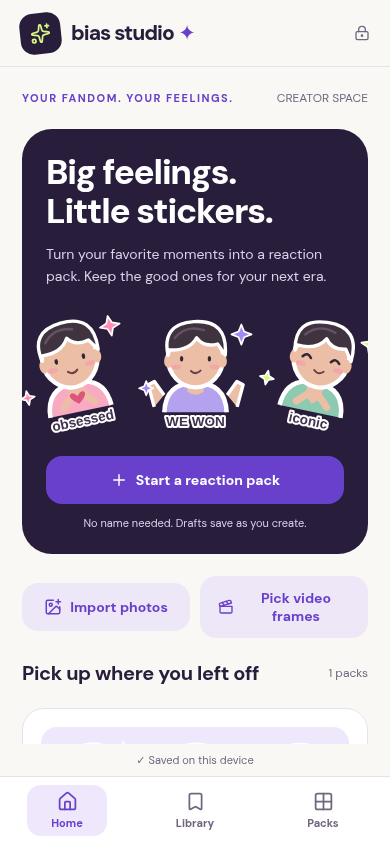
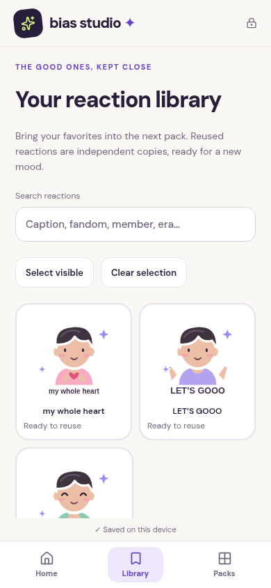
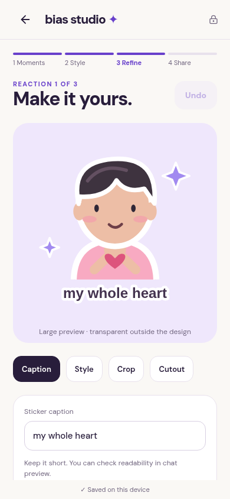
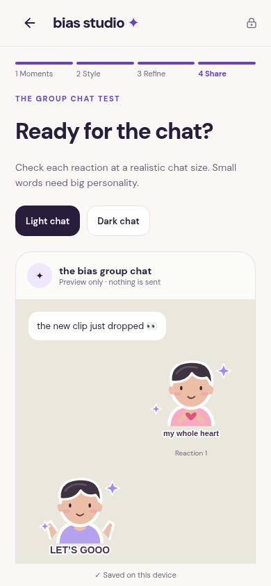

# Bias Studio

**Turn your favorite moments into a reaction pack—and build a reusable library for your fandom.**

A mobile-first creator workspace for iPhone and Android, built on Expo SDK 54 / React Native. The browser preview uses the same editor and workspace. Original illustrative demo characters are included; no celebrity photos are bundled.

[](https://github.com/toreleon/bias-studio/actions/workflows/ci.yml)

## What works

- Start immediately, name later, and resume automatically saved, editable drafts.
- Import multiple photos or select several **still frames** from a video. Preserve the frame timestamps and source name.
- Style selected reactions together: fonts, caption placement, outline width/color, ink, frames, accent colors and decoration. Save a style for future packs.
- Refine individual captions and crop; native person cutout; manual erase/restore brushes; undo; accessible earlier/later reordering.
- Save editable reactions to a reusable library, with optional fandom, member/character, era/event and emotion tags. Search/filter, duplicate and reuse independent copies across packs.
- Preview every sticker at 148 logical pixels against light/dark chat backgrounds.
- Native WhatsApp handoff with 3–30 validated, transparent 512 × 512 WebP files, ≤100 KiB each, plus a 96 × 96 PNG tray icon ≤50 KiB. The app reports **handoff**, never unverified installation.
- Export one portable ZIP containing editable designs, original/cutout images, captions, tags, timestamps, creator credit, collection identity and ready-rendered WebP stickers. Import it on another installation through **Packs → Import pack file**.
- Preserve v1 packs and the original storage key during migration. Legacy stickers remain reusable as flattened images; their baked-in text cannot be independently edited.

Automatic person cutout uses Apple Vision on iOS and bundled ML Kit person segmentation on Android. Manual correction works on both platforms and in the browser. There is no animated output, account, backend, public page, cloud sync, marketplace or subscription. Unpublished work stays on the device. A shared ZIP deliberately contains the editable source assets; the app explains this before sharing.

## Main screens

Actual 390px mobile **browser** captures of the implemented app; these are not physical-device screenshots.

| Home | Reaction library | Pack |
| --- | --- | --- |
|  |  |  |

| Individual editor | Chat preview |
| --- | --- |
|  |  |

## Run and test

Use Node 22 and npm:

```sh
npm ci
npm run web
```

Open the Expo URL (port 8081). Try the three-reaction demo or import PNG/JPEG photos and an MP4 video. The preview supports real editing, saving, importing/exporting pack files and downloads. Native WhatsApp actions are not displayed in the browser. Browser storage quotas apply; clearing site data removes that browser's workspace. Use pack files as portable copies.

```sh
npm run check                 # zero-warning lint, TypeScript, domain/workspace tests
npm run test:release          # fail-closed release-policy tests
npx playwright install chromium
CI=1 npm run test:e2e         # creator workflows, migration, failures, screenshots
npm run export:web           # production browser bundle
```

If Chromium is already installed, use `CHROMIUM_PATH=/usr/bin/chromium CI=1 npm run test:e2e`. Production web hosting needs an SPA fallback to `index.html` for Expo Router deep links; `npx serve -s dist` is suitable for a local exported preview.

## Build for phones

**Expo Go does not contain the custom native module.** Use a development or standalone build. The Kotlin/Swift module lives in `modules/fan-stickers` and autolinks. Generated root `android/` and `ios/` directories are disposable; configure them through `app.json` or module sources.

Android: install JDK 17, Android SDK 36/build tools, configure `ANDROID_HOME`, and connect a phone or start an emulator:

```sh
npm ci
npm run android
```

iPhone: macOS, Xcode, CocoaPods, a signing team and connected device are required:

```sh
npm ci
npm run ios -- --device
```

EAS profiles are included. Supply your own Expo account and Apple provisioning for iPhone builds:

```sh
npx eas-cli@latest login
npx eas-cli@latest build:configure
npx eas-cli@latest build --platform android --profile development
npx eas-cli@latest build --platform ios --profile development
npm start
```

For unsigned simulator testing use `--platform ios --profile ios-simulator`. Simulator apps cannot be installed on iPhones or validate WhatsApp installation. Replace the working `studio.bias.app` identifiers and template signing configuration before production distribution.

## Acceptance walkthrough

1. On Home, choose **Import photos**, select three images, and enter the pack immediately. No name is required.
2. Use **Style selected** to choose a font/color/placement. Enter a style name and save it. Refine one reaction's caption or cutout; the others stay intact.
3. Optionally organize reactions with fandom/member/era/emotion tags. **Save to library** snapshots the selected editable designs. Save again after later refinements to update those library copies.
4. Name the collection and add creator credit. Wait for **Saved on this device**, close the app, then reopen the draft from Home.
5. Open **Library**, search/filter, select reactions, then **New pack from … reactions**. Apply your saved style from the new pack's styling panel. These are independent copies; editing the second pack preserves the first.
6. **Preview in chat**, then share/download a pack ZIP. On another installation, open **Packs → Import pack file**. It remains a private collection until shared again.
7. In the native app, use **Add to WhatsApp** once the pack has 3–30 stickers. Confirm inside WhatsApp, then send the stickers there. A file share or return to Bias Studio is not proof of installation.

The test suite automates the two-pack acceptance scenario. Faster second-pack creation is a product hypothesis, not a measured user-study result. See [product direction and validation](docs/PRODUCT.md), [architecture and data](docs/ARCHITECTURE.md), and [verification/device checklist](docs/VERIFICATION.md).

## CI and release safety

The existing protected-main and human release-approval policies are retained. Every PR gates on quality, browser workflows, Android native build/release lint and iOS Release Simulator compilation. Actions remain SHA-pinned; PRs receive no production signing credentials. Release candidates require exact successful main CI artifacts, checksum verification and explicit physical-device signoff. See [RELEASING.md](docs/RELEASING.md).

Test artifacts are an ARM64 Android APK using the template debug key, an unsigned iOS Simulator app and a web-preview ZIP. They are not store releases. The workflow does not submit to stores, and no release is dispatched as part of this revamp.

## Known boundaries

- Automatic cutout targets people. Brush corrections are in canvas coordinates; crop first, then refine edges. Undo history (20 workspace snapshots) lasts for the current session; designs and strokes persist across restarts.
- Frames already added to a draft persist. The video-selection sheet is temporary: finish **Add frames to pack** before closing. Reimport a video to select additional frames later. Video decoding depends on OS/browser codec support.
- Browser image data can exhaust local storage; unsaved changes stay in memory, the status shows **Not saved**, and retry is available. Do not close while that status is shown. Native sources and cutouts use app document storage, not expiring picker/cache paths.
- Pack ZIPs are limited to 32 MiB compressed / 60 MiB metadata. They include original media images; video files themselves are not shared. No public URLs are generated.
- Native source files and exported WhatsApp snapshots are retained to protect drafts, library references and installed-pack reads. Automatic orphan collection and stable in-place WhatsApp updates are follow-up work; changed packs may install as separate revisions.
- Native compilation is not physical-device acceptance. Validate source persistence, capture/masking, share-sheet delivery, VoiceOver/TalkBack, and WhatsApp acceptance on actual Android and iPhone hardware before releasing.
- Telegram, iMessage and Snapchat actions are absent. Destination adapters are separated from rendering for later integrations. Snapchat would require its supported sharing flow, not an assumed reusable-chat-pack installer.

The app does not upload source photos. Review ML Kit SDK privacy terms and OS backup behavior for store disclosures (Android backup is disabled). Use media you have permission to use. Bias Studio is not affiliated with artists or messaging platforms.

## Protocol references

- [WhatsApp Android sticker requirements/provider sample](https://github.com/WhatsApp/stickers/tree/main/Android)
- [WhatsApp iOS pasteboard protocol](https://github.com/WhatsApp/stickers/tree/main/iOS)
- [Apple Vision person segmentation](https://developer.apple.com/documentation/vision/vngeneratepersonsegmentationrequest)
- [ML Kit selfie segmentation](https://developers.google.com/ml-kit/vision/selfie-segmentation/android)
