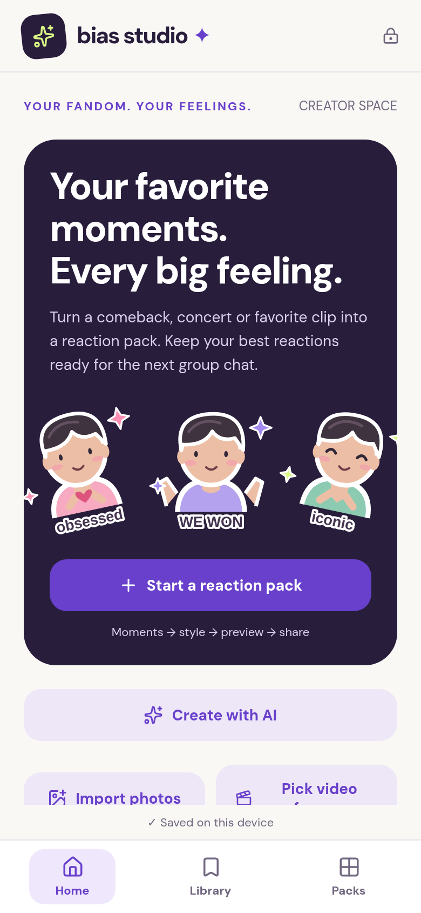
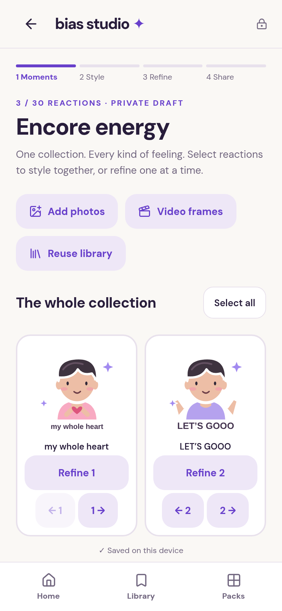
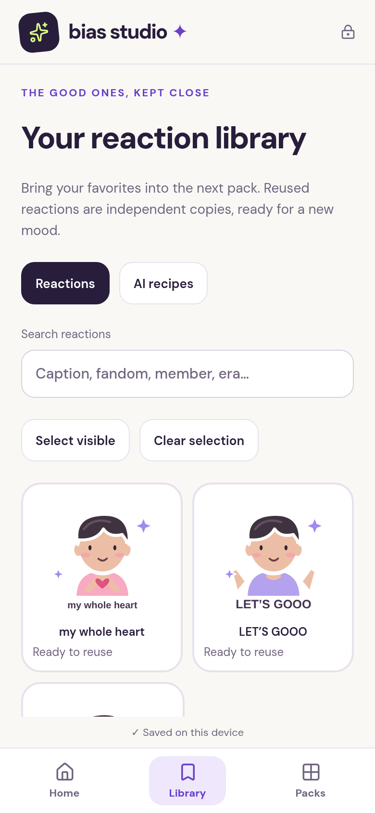
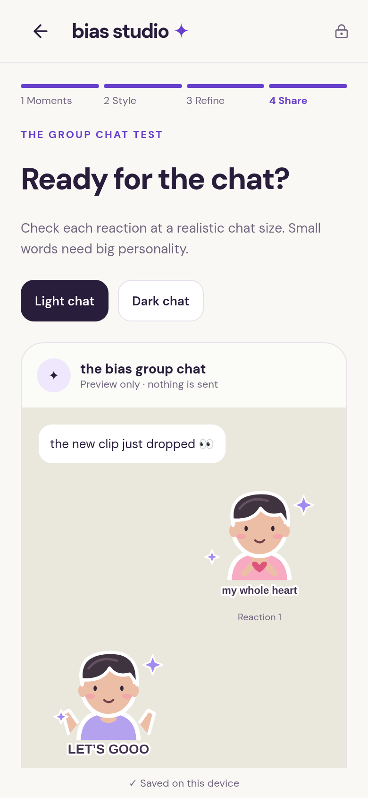
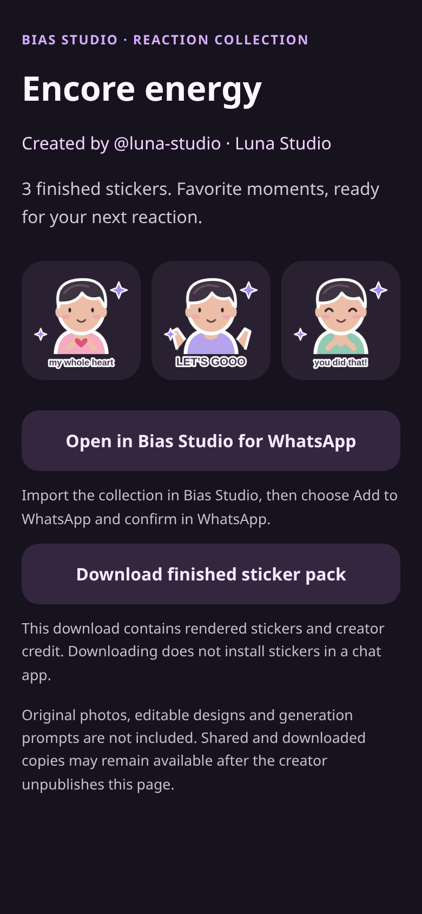
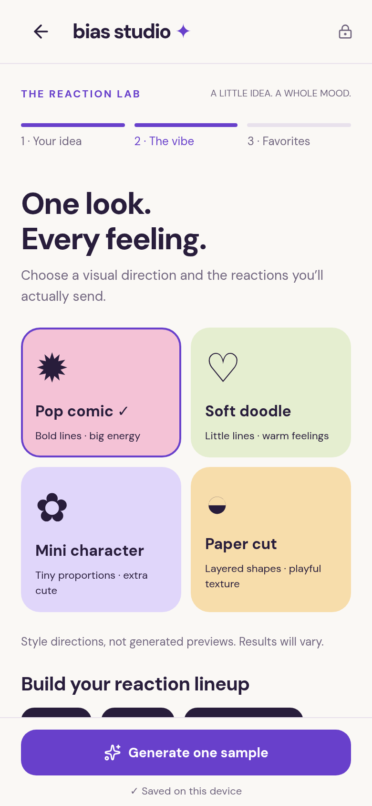

# Bias Studio

**Turn your favorite moments into a reaction pack—and build a reusable library for your fandom.**

A mobile-first creator workspace for iPhone and Android, built with Expo SDK 54 / React Native, plus a small backend for finished-pack distribution and optional image generation. A browser preview uses the same editor and local workspace. Original illustrative demo characters are included; no celebrity photos are bundled.

[](https://github.com/toreleon/bias-studio/actions/workflows/ci.yml)

## Beta scope and evidence

The creator workflow, rendered-only sharing, public collection service, Telegram adapter and durable generation jobs are implemented in this repository. **The public service is not deployed by this change.** Live Telegram creation needs a configured bot/webhook; physical WhatsApp installation and sending remain device-validation gates. Mock provider tests do not establish live model quality or recipient success. See [current beta verification](docs/BETA-VERIFICATION.md) for exact results, builds and blockers.

- [Beta strategy](docs/BETA-STRATEGY.md) and [consent-based pilot protocol](docs/PILOT.md)
- [Deployment and operational checklist](docs/BETA-DEPLOYMENT.md)
- [Generation setup](docs/GENERATION-SETUP.md), [product behavior](docs/PRODUCT.md) and [architecture](docs/ARCHITECTURE.md)
- Research: [direct competitors](docs/research/direct-competitors.md), [platforms](docs/research/platform-competitors.md), [baseline audit](docs/research/product-audit.md) and [strategy challenge](docs/research/strategy-challenge.md)

Competitors already offer editing, packs, generation and distribution. Faster repeated creation, useful reusable libraries and recipient adoption are hypotheses to validate—not established differentiation, retention or willingness to pay.

## Creator and recipient workflows

- Start immediately, name later, and resume locally autosaved drafts. Import multiple photos or choose several **still frames** from a video, preserving source names/timestamps.
- Batch-style selected reactions; refine captions/crop, person cutouts and erase/restore masks; undo and reorder. Save editable assets and styles, organize optional fandom/member/era/emotion tags, and reuse independent copies in another pack.
- Preview at realistic chat sizes. Share a **finished-only ZIP** by default; editable backup sharing is a separate explicit choice containing sources and authoring metadata.
- Native WhatsApp handoff validates 3–30 static 512 × 512 WebP stickers, each ≤100 KiB, and a 96 × 96 tray PNG ≤50 KiB. Confirm Add inside WhatsApp, then send a sticker there.
- With a connected beta service, explicitly publish finished renders, chosen credit and the disclosed creator account label to an anonymous collection page, or link Telegram and create a real sticker set. Public pages can be unpublished; downloaded copies and Telegram sets are separate and cannot be recalled by hiding a page.
- Optional AI creation starts with one sample for approval, then selected reactions, individual variations and independent captions. Saved recipes and generation request IDs support reuse and recovery. The beta service defaults to `gpt-image-2.6-sunburst`; model availability and output quality still require bounded live validation.

**Saved locally**, **destination opened/handoff**, and **pack installed and used** are different states. A file download, published page, verified Telegram set or opened WhatsApp does not prove that the recipient added or sent a sticker.

Drafts remain local. Publishing sends final rendered images, public credit and the disclosed creator account label only. An explicit AI request sends its description/reference to the private service and provider; job results are retained for recovery under the operator's retention policy. Provider credentials never belong in the app. No broad feed, marketplace, subscription, team workspace, cloud library sync or animated output is offered.

## Main screens

Beta mobile-browser screenshots, not physical-device evidence. Generation illustrations/fixtures and capture provenance are identified in [beta verification](docs/BETA-VERIFICATION.md). Earlier screenshots under `docs/screenshots/ai/` and the original screen files remain historical assets.

| Home | Pack | Editor |
| --- | --- | --- |
|  |  |  |

| Library | Preview and sharing | Public collection |
| --- | --- | --- |
|  |  |  |

| AI sample approval |
| --- |
|  |

## Run and test

Use **Node 22.16 or newer**; the beta service uses built-in SQLite. For the offline creator workspace:

```sh
npm ci
npm run web
```

For local online features, follow [generation setup](docs/GENERATION-SETUP.md) to create a private environment file and creator invite, then run the service and app in separate terminals:

```sh
npm run beta:serve
```

```sh
EXPO_PUBLIC_BETA_URL=http://localhost:8788 npm run web
```

An API key is optional for testing local publishing; it is needed for real generation. Telegram actions require the configured bot integration. A localhost URL is not a publicly reachable collection service. `npm run generation:serve` is the **legacy local adapter harness**, not the authenticated beta backend used by the current UI.

```sh
npm run check                 # lint, TypeScript, workspace and beta service tests
npm run test:release          # release-policy tests
npx playwright install chromium
CI=1 npm run test:e2e         # creator/recipient browser flows with test providers
npm run export:web
```

If Chromium is installed, use `CHROMIUM_PATH=/usr/bin/chromium CI=1 npm run test:e2e`. Expo Router web hosting needs an SPA fallback to `index.html`; backend `/p/...` pages and API routes must reach the beta service. See the deployment guide for the actual hosting boundary.

## Build for phones

**Expo Go does not contain the custom native module.** Use a development or standalone build. The Kotlin/Swift module lives in `modules/fan-stickers` and autolinks. Generated root `android/` and `ios/` directories are disposable; configure them through `app.json` or module sources.

Android: install JDK 17, Android SDK 36/build tools, configure `ANDROID_HOME`, and connect a phone or start an emulator:

```sh
npm ci
npm run android
```

iPhone: macOS, Xcode, CocoaPods, a signing team and connected device are required:

```sh
npm ci
npm run ios -- --device
```

EAS profiles are included. Supply your own Expo account and Apple provisioning for iPhone builds:

```sh
npx eas-cli@latest login
npx eas-cli@latest build:configure
npx eas-cli@latest build --platform android --profile development
npx eas-cli@latest build --platform ios --profile development
npm start
```

For unsigned simulator testing use `--platform ios --profile ios-simulator`. Simulator apps cannot be installed on iPhones or validate WhatsApp installation. Replace the working `studio.bias.app` identifiers and template signing configuration before production distribution.

## Acceptance walkthrough

1. Import several photos or video moments. Style the selection, refine one reaction and save a named style.
2. Save useful reactions to Library, optionally add tags, and add collection name/creator credit when ready.
3. Wait for **Saved on this device**, close/reopen, and verify the same draft and timestamps.
4. Search Library, create a second pack from saved reactions and apply the saved style. Edit the second pack and verify the first remains unchanged.
5. Preview in chat. Share a finished-only ZIP; on another installation use **Packs → Import pack file**. Sources and editable layers are shared only through the separate editable option.
6. On a supported native build, choose **Add to WhatsApp**, confirm inside WhatsApp, and send a sticker. Record actual success separately from handoff.
7. With a configured service/invite, publish a finished collection and open its page without signing in. If Telegram is configured, connect through the bot, create the set, open it as a recipient and confirm add/send there. Unpublish and verify the Bias page becomes unavailable.
8. For optional AI, approve one sample, generate selected reactions, pause/reopen and recover saved requests. A new variation is a separate attempt; recovery reuses the existing request.

The software acceptance scenario does not prove a faster second pack for real creators. Use [PILOT.md](docs/PILOT.md) to measure effort, corrections, recipient use, voluntary return and cost per unique retained output.

## CI and release safety

The existing protected-main and human release-approval policies are retained. Every PR gates on quality, browser workflows, Android native build/release lint and iOS Release Simulator compilation. Actions remain SHA-pinned; PRs receive no production signing credentials. Release candidates require exact successful main CI artifacts, checksum verification and explicit physical-device signoff. See [RELEASING.md](docs/RELEASING.md).

Test artifacts are an ARM64 Android APK using the template debug key, an unsigned iOS Simulator app and a web-preview ZIP. They are not store releases. The workflow does not submit to stores, and no release is dispatched as part of this revamp.

## Known boundaries

- Automatic cutout targets people (Apple Vision / Android ML Kit). Crop before manual canvas-space corrections. Undo retains 20 session snapshots; saved designs/strokes persist.
- Video selection is temporary until **Add frames to pack**. Added frame images/timestamps persist; the original video and uncommitted selection do not. Codec support varies by device.
- Browser images are compacted before storage, but localStorage remains finite. **Not saved** means edits remain only in memory: free space and retry before closing. Clearing app/site storage removes the local workspace; keep intentional backups.
- Legacy migration preserves the original v1 key and handles repeated sticker IDs across packs. Flattened legacy/rendered-only images cannot regain editable baked-in captions.
- Beta SQLite is private persistent storage for one service/worker instance. Invite sessions and owner isolation are implemented; self-service account registration, multi-region scaling and cloud library sync are not. Durable generation reservations are configured estimates, not provider bills.
- Native files and immutable WhatsApp snapshots are retained conservatively. Device upgrade/container-path persistence, storage cleanup, sharing/accessibility and destination behavior need hardware checks. Changed packs may install as new revisions.
- Telegram has a real Bot API adapter with mock integration coverage; live set creation and recipient installation require credentials and devices. iMessage and Snapchat integrations are absent.
- Public pages are implemented, not deployed. HTTPS hosting, persistent storage, operational retention/backups, bot configuration and signed phone distribution remain explicit deployment work.

The earlier 1.2 live browser observation used `gpt-image-1.5`; it is **historical evidence only**, not validation of this beta model or service. See [historical verification](docs/VERIFICATION.md) and [earlier generative research](docs/GENERATIVE-UX-RESEARCH.md). OpenAI lists the 1.5 shutdown for December 1, 2026 in its [deprecations](https://developers.openai.com/api/docs/deprecations).

Use media you have permission to use. Review provider, ML Kit and OS backup behavior for disclosures. Bias Studio is not affiliated with artists or messaging platforms.

## Protocol references

- [WhatsApp Android requirements/provider sample](https://github.com/WhatsApp/stickers/tree/main/Android)
- [WhatsApp iOS pasteboard protocol](https://github.com/WhatsApp/stickers/tree/main/iOS)
- [Telegram Bot API](https://core.telegram.org/bots/api#createNewStickerSet)
- [Apple Vision segmentation](https://developer.apple.com/documentation/vision/vngeneratepersonsegmentationrequest)
- [ML Kit selfie segmentation](https://developers.google.com/ml-kit/vision/selfie-segmentation/android)
